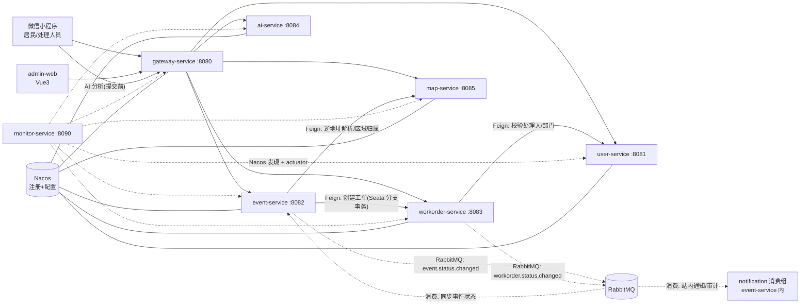
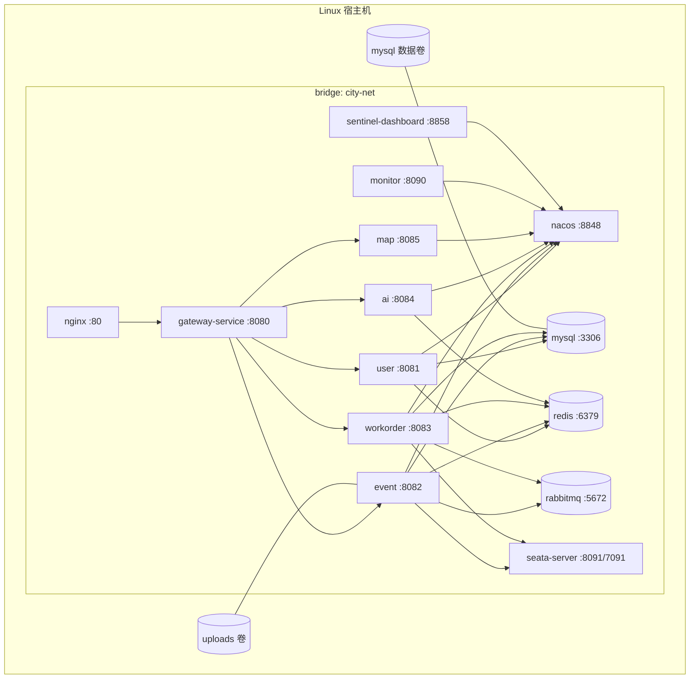

# 架构设计说明书

> 文档版本：v0.1（第一阶段规划稿）
> 对应需求：[requirements.md](./requirements.md)
> 说明：本文件中的版本结论均标注了依据来源；标注「待验证」的条目必须在编码阶段用实际依赖树或启动日志确认，不得视为已确认结论。

---

## 1. 现状检查结论（规划前置）

| 检查项 | 结论 |
| --- | --- |
| 目录内容 | 已存在一套**微信小程序 TS + Less 快速启动模板**：`miniprogram/`、`typings/`、`project.config.json`、`project.private.config.json`、`package.json`、`tsconfig.json` |
| Git | **不是 Git 仓库**（`git rev-parse` 返回 128），无提交历史 |
| 后端代码 | 无（无 `pom.xml`、无 Java 源码） |
| 小程序 AppID | `wx6e2a9f37005ab6aa`（`project.config.json` 已配置） |
| 本地工具链 | JDK 17.0.10（Microsoft）、Maven 3.9.9、Node 24.17.0、npm 11.13.0、Git 2.48.1 |
| Docker | **本机未安装 Docker**，无法在 Windows 侧验证 Compose，必须改在 Linux 服务器验证 |
| 规范/踩坑文档 | 无（本阶段新建 `docs/`，未发现既有规范文档） |

**处理原则**：

1. 不删除、不覆盖任何现有小程序文件；小程序继续以项目根目录作为开发者工具工程目录（`miniprogramRoot: miniprogram/`）。
2. 后端工程与小程序工程共存于同一根目录，互不影响构建：Maven 只管理 `pom.xml` 声明的模块，微信开发者工具只管理 `miniprogram/`、`typings/` 等。
3. 第一阶段结束前不初始化 Git 仓库、不提交代码，等待确认后执行 `git init`。

---

## 2. 框架版本矩阵

### 2.1 核心版本

| 组件 | 选定版本 | 选择依据 | 状态 |
| --- | --- | --- | --- |
| JDK | 17（LTS，本机 17.0.10） | Spring Boot 3.x 最低要求 17；本地已安装 | 已确认 |
| Spring Boot | 3.2.12 | 3.2.x 分支最后补丁版本（Maven Central `spring-boot-dependencies` 元数据存在 3.2.12） | 已确认存在 |
| Spring Cloud | 2023.0.3 | Spring Cloud 2023.0.x（Leyton）适配 Boot 3.2.x；该版本已发布 | 已确认存在 |
| Spring Cloud Alibaba | 2023.0.3.3 | Maven Central 最新 2023.x 之一；其父 POM 为 `spring-cloud-dependencies-parent:4.1.0`（对应 2023.0.x 分支） | 已确认存在 |
| Nacos Client | 2.4.2 | 由 SCA 2023.0.3.3 BOM 直接管理，不手写版本 | 已确认（BOM 属性） |
| Nacos Server | 2.4.3（镜像 tag） | 客户端 2.4.x 对应服务端 2.4.x；镜像 tag 需在部署阶段 `docker pull` 确认 | **待验证** |
| Sentinel | 1.8.8 | SCA 2023.0.3.3 BOM 管理；Dashboard 同版本 | 已确认（BOM 属性） |
| Seata | 2.1.0 | SCA 2023.0.3.3 BOM 管理；Server 镜像同版本 | 已确认（BOM 属性） |
| MyBatis-Plus | 3.5.7（`mybatis-plus-spring-boot3-starter`） | Boot 3 专用 starter；3.5.9+ 拆分出 `mybatis-plus-jsqlparser`，分页插件需额外依赖，3.5.7 可开箱使用 | 已确认存在 |
| Druid | 1.2.23（`druid-spring-boot-3-starter`） | Boot 3 专用 starter，版本已在 Maven Central 发布 | 已确认存在 |
| Sa-Token | 1.44.0（`sa-token-spring-boot3-starter`、`sa-token-reactor-spring-boot3-starter`、`sa-token-redis-jackson`） | 三个 Boot3 模块均存在于 Maven Central 1.44.0 | 已确认存在 |
| Spring Boot Admin | 3.2.3（server + client） | 官方兼容矩阵：SBA 3.x 要求 Boot 3.x，版本号与 Boot minor 对齐；选 3.2.x 与 Boot 3.2 对齐 | 已启动验证，Nacos 发现模式 |
| MySQL | 8.0.x（镜像 8.0 系列） | 需求指定 8.0 | 已确认需求 |
| Redis | 7.2.x 镜像 | 与 Spring Data Redis（Boot 3.2 管理）兼容 | 部署阶段确认 tag |
| RabbitMQ | 3.13.x `-management` 镜像 | Spring AMQP 3.x 稳定支持的版本线 | 部署阶段确认 tag |
| Logback | Boot 3.2 自带（1.4.x） | 不单独指定版本 | 已确认 |
| Maven | 3.9.9 | 本机已装 | 已确认 |
| Node.js | 20 LTS（构建镜像）/ 本机 24 可用于开发 | Vite 5 支持 18+；CI/镜像统一 20 避免版本漂移 | 已确认 |

### 2.2 为什么固定为 Spring Boot 3.2.x，而不是 3.3/3.4/4.x

- SCA `2023.0.x` 官方适配矩阵为 Boot 3.2.x；升级到 Boot 3.3+ 需要 Spring Cloud 2023.0.4+ 或 2024.x，与 SCA 的兼容性需要重新验证。
- Spring Boot 4.x / Spring Cloud 2025.x 虽然已发布，但 SCA 对应版本（2025.x 分支）生态资料少、与 Seata/Sentinel 组合缺少课程级别的可复现验证，不适合 2–4 周课程项目。
- 本项目锁定"Boot 3.2.12 + Cloud 2023.0.3 + SCA 2023.0.3.3"这一组**已发布且互相适配**的版本，并在父 POM 中用 `dependencyManagement` 统一收敛，避免各模块自行改版本。

### 2.3 前端版本

| 组件 | 版本 | 说明 |
| --- | --- | --- |
| 微信小程序 | 基础库 3.x（当前工程配置 `libVersion: 2.32.3`，实现阶段可提升） | 保留现有 TS + Less 编译插件 |
| Vue | 3.4.x | 团队熟悉 Vue |
| Vite | 5.x | 与 Node 20 兼容 |
| Element Plus | 2.9.x | 管理后台组件库 |
| Pinia | 2.2.x | 状态管理 |
| Axios | 1.7.x | 统一请求封装、Token 注入 |
| ECharts | 5.5.x | 统计图表 |
| 腾讯位置服务 JS API GL | 1.x | 管理后台地图打点/聚合 |

### 2.4 待验证清单（实现阶段必须逐条落实）

| 编号 | 待验证项 | 验证方式 | 失败时的备选 |
| --- | --- | --- | --- |
| V1 | Seata 2.1.0 在 Boot 3.2 下的自动配置与 Druid 数据源代理顺序 | 启动日志出现 `DataSourceProxy`，`undo_log` 可写入；执行一次全局事务 | 显式配置 `@EnableAutoDataSourceProxy`，或将 Seata 代理配置为手动 `DataSourceProxy` |
| V2 | SCA 2023.0.3.3 与 Boot 3.2.12 的 Nacos 配置导入（`spring.config.import`）行为 | 启动读取 Nacos 配置并动态刷新日志级别 | 退回 `bootstrap.yml` + `spring-cloud-starter-bootstrap` |
| V3 | Gateway 侧 Sa-Token Reactor 与 Sentinel Gateway 适配器共存 | 同时开启鉴权与限流，网关正常启动 | 分两个 GlobalFilter，Sentinel 规则改用 `sentinel-spring-cloud-gateway-adapter` 独立配置 |
| V4 | Nacos 2.4.x 在 Docker 内的 gRPC 端口（9848/9849）映射 | 容器内服务注册成功、控制台可见实例 | 使用 host 网络或显式映射 8848/9848/9849 |
| V5 | SBA 3.2.3 通过 Nacos 发现服务并读取 actuator | 控制台出现全部服务且状态 UP | 改用 SBA client 直连注册模式 |
| V6 | MyBatis-Plus 3.5.7 分页插件在 Boot 3.2 正常 | 分页查询返回 total 正确 | 升 3.5.12 + `mybatis-plus-jsqlparser` |

---

## 3. 服务划分与职责

### 3.1 划分原则

1. **按业务能力划分，不按技术层划分**：每个服务拥有独立数据库，禁止跨库直连、禁止他服务直接写本服务表。
2. **拆分必须有独立数据与独立生命周期**：不为"看起来像微服务"而拆。
3. **AI 与地图独立成服务**：二者都是外部依赖适配层，有独立的限流/熔断/降级策略和独立调用日志，且被多个服务复用，拆分有实际收益。
4. **监控服务独立**：Spring Boot Admin Server 需要 Servlet Web 容器，不能并入 WebFlux 网关，也不应塞进业务服务。

### 3.2 服务清单

| 模块 | 端口 | 数据库 | 核心职责 | 不负责 |
| --- | --- | --- | --- | --- |
| `gateway-service` | 8080 | 无 | 统一入口、路由、Token 校验、角色路由拦截、限流、traceId 生成 | 业务逻辑、数据库访问 |
| `user-service` | 8081 | `city_user` | 账号、角色、微信登录换 openid、处理人员部门、用户管理 | 事件/工单数据 |
| `event-service` | 8082 | `city_event` | 事件主数据、附件元数据、审核、状态机、居民查询、统计查询 | 工单生命周期 |
| `workorder-service` | 8083 | `city_workorder` | 工单创建、接单、处理记录、提交结果、验收、改派 | 事件主数据写入 |
| `ai-service` | 8084 | `city_ai` | 大模型适配、提示词、结构化输出校验、调用日志、降级策略 | 事件状态变更 |
| `map-service` | 8085 | `city_map` | 腾讯位置服务适配、逆地址解析、行政区归属、区域字典、地图聚合数据 | 事件业务判断 |
| `monitor-service` | 8090 | 无 | Spring Boot Admin Server，聚合各服务健康状态 | 业务 |
| `admin-web` | 80（Nginx） | 无 | 管理员 Web 后台（Vue SPA） | — |
| `miniprogram` | — | — | 居民端 + 处理人员端小程序 | — |

> 注册到 Nacos 的业务服务共 6 个：`gateway-service` + 5 个业务服务；`monitor-service` 作为监控端自身不参与业务注册计数（SBA 据此展示 6 个服务实例）。

### 3.3 服务调用关系



**调用链说明**

| 链路 | 类型 | 用途 | 是否在全局事务内 |
| --- | --- | --- | --- |
| 客户端 → Gateway → 各服务 | HTTP | 统一入口 | 否 |
| 小程序 → `ai-service` 分析接口 | HTTP（经网关） | 提交前 AI 建议，同步返回 | 否（外部 API 不可回滚） |
| `event-service` → `map-service` | OpenFeign | 提交事件时补齐行政区/街道/区域编码 | 否（外部 HTTP，先于事务执行） |
| `event-service` → `workorder-service` | OpenFeign + Seata AT | 审核通过时原子创建工单 | **是** |
| `workorder-service` → `user-service` | OpenFeign | 校验处理人角色与部门（派单/改派） | 否（只读） |
| 工单状态变更 → MQ → `event-service` | 异步消息 | 事件状态最终一致 | 否（明确排除在全局事务外） |

> 设计意图：`event-service` 只通过 Feign 调用 `workorder-service`，反向同步走 MQ，**避免服务间双向同步调用形成环**。

### 3.4 数据归属矩阵

| 数据实体 | 归属服务 | 其他服务访问方式 |
| --- | --- | --- |
| 用户、角色、用户角色关联、处理人员部门 | `user-service` | Feign 只读接口 |
| 事件、事件附件元数据、事件状态流水、审核记录、AI 建议快照 | `event-service` | Feign 只读接口 + MQ 状态同步 |
| 工单、工单处理记录、验收记录、改派记录 | `workorder-service` | Feign 只读接口 |
| AI 调用日志、提示词模板 | `ai-service` | 无（内部使用） |
| 行政区/区域字典、地图调用日志 | `map-service` | Feign 只读接口 |
| 上传文件实体 | 文件系统挂载卷 | 数据库只存元数据与访问路径 |

**禁止事项**：

- 任何服务不得直连其他服务的数据库，不得写其他服务的表。
- `undo_log` 表仅存在于参与 Seata AT 的库（`city_event`、`city_workorder`）。
- 附件文件不属于数据库，数据库只保存 `file_name / file_path / file_size / content_type / sha256 / uploader_id`。

---

## 4. 关键技术落地设计

### 4.1 Nacos（注册 + 配置）

- **注册中心**：所有业务服务与网关注册到 `NACOS_ADDR`（容器内 `nacos:8848`），命名空间 `public`，分组 `CITY_PLATFORM`。
- **配置中心**：使用共享配置 + 服务私有配置两级：
  - `city-common.yaml`（公共：日志、Jackson、MyBatis-Plus、Sa-Token、actuator、错误码开关）
  - `{service-name}.yaml`（私有：数据源、业务参数、限流开关）
- 加载方式：`spring.config.import: optional:nacos:city-common.yaml,optional:nacos:${spring.application.name}.yaml`，group 统一 `CITY_PLATFORM`。
- **验证方式**：Nacos 控制台"服务列表"可见全部实例；在线把某服务日志级别从 INFO 改为 DEBUG，观察日志输出变化且无需重启。

### 4.2 Gateway

- 路由按路径前缀，不做 `StripPrefix`，服务内 Controller 即带完整前缀，保证 Feign 与外部调用路径一致：
  | 断言 | 目标 |
  | --- | --- |
  | `/api/v1/auth/**`、`/api/v1/users/**`、`/api/v1/workers/**` | `lb://user-service` |
  | `/api/v1/events/**`、`/api/v1/attachments/**` | `lb://event-service` |
  | `/api/v1/workorders/**` | `lb://workorder-service` |
  | `/api/v1/ai/**` | `lb://ai-service` |
  | `/api/v1/map/**` | `lb://map-service` |
- **不路由** `/internal/**`，内部接口只允许服务间调用（校验内部调用头）。
- 全局过滤器顺序：`TraceIdFilter`（-100）→ `AuthFilter`（-90）→ `RoleRouteFilter`（-80）→ 转发。
- 鉴权白名单：`/api/v1/auth/login`、`/api/v1/auth/wx-login`、`/api/v1/map/public/**`、actuator（仅内网）。

### 4.3 OpenFeign

- 统一封装在 `common-api`：`@FeignClient(name = "event-service", path = "/internal/v1/events")` 等接口声明 + DTO，避免各服务重复定义。
- 统一配置：连接超时 2s、读超时 5s（AI 相关单独 15s）、重试关闭（避免非幂等重复）、日志级别 BASIC。
- Feign `RequestInterceptor` 透传 `X-Trace-Id`、`X-Internal-Token`、`Authorization`。
- **真实跨服务链路**：居民提交事件 → `event-service` 用 Feign 调 `map-service` 逆地址解析 → 返回区域编码并落库；派单时 `workorder-service` 用 Feign 调 `user-service` 校验处理人。

### 4.4 Sentinel

| 位置 | 规则 | 阈值（演示值） | 效果 |
| --- | --- | --- | --- |
| Gateway（`/api/v1/events/**`、`/api/v1/ai/**`） | 路由级 QPS 限流 | 单路由 20 QPS（AI 5 QPS） | 超限返回统一 `42901` |
| `ai-service` | 熔断（慢调用比例 RT>3000ms、比例 100%、窗口 10s、熔断 10s） | — | `CIRCUIT_OPEN` 降级（降级结果仍可用于手动上报） |
| `map-service` | 慢调用比例降级（RT > 2s） | 比例 60% | 返回"地址待人工确认"，不阻断提交 |

- 规则当前在应用启动时加载（`SentinelGatewayConfiguration`、`SentinelRuleConfig`），后续可迁移到 Nacos 数据源。
- **验证方式**：脚本并发请求事件接口触发 429；AI 通过故障注入触发慢调用熔断，详见 `docs/p5-test-report.md`。

### 4.5 Seata AT（分布式事务）

**唯一全局事务场景**：管理员审核通过并派单。

```
入口：event-service # approveAndDispatch(eventId, assignedWorkerId)
@GlobalTransactional(name = "approve-and-dispatch")
  1. event-service：校验状态 → UPDATE t_event(status=DISPATCHED, category, priority, auditor_id)
  2. event-service：INSERT t_event_audit_log
  3. OpenFeign → workorder-service #createWorkorder：
       INSERT t_workorder(status=PENDING_ACCEPT, event_id, worker_id, priority)
       INSERT t_workorder_log(type=CREATE)
  提交后（事务外）：发送 MQ event.status.changed
```

- **事务边界**：只包含两库的数据库写操作。AI 调用、地图调用、文件上传、MQ 发送均在事务外。
- **回滚验证（故障注入）**：`workorder-service` 读取 Nacos 配置 `demo.fault.create-workorder=true` 时，在插入工单后抛 `BizException`；预期结果：
  1. 接口返回 500/业务失败；
  2. `t_event` 状态仍为 `PENDING_REVIEW`（未被提交）；
  3. `t_workorder` 无新增记录；
  4. 两库 `undo_log` 被回滚清理；
  5. Seata Server 控制台无残留全局事务。
- 参与方必须：使用相同事务分组、`undo_log` 表存在、`Druid` 数据源被 Seata 代理（V1 待验证）。

### 4.6 MySQL + MyBatis-Plus + Druid

- 每服务独立库，独立数据源；`HikariCP` 不使用，统一 Druid（需求指定）。
- Druid 配置：初始 2、最小 2、最大 20、`validation-query: SELECT 1`、`stat-view-servlet` 仅在 `dev` 开放。
- MyBatis-Plus：逻辑删除（`deleted`）、自动填充（`create_time/update_time/create_by/update_by`）、乐观锁（`version`，工单接单使用）、分页插件、防全表更新。
- SQL 规范见 [database.md](./database.md)。

### 4.7 Redis（两项真实用途）

| 用途 | Key 设计 | TTL | 说明 |
| --- | --- | --- | --- |
| Sa-Token 会话共享 | `Authorization:login:token:{token}`、`Authorization:login:session:{userId}` | 2h（滑动续期） | 网关与业务服务共享登录态，支持登出/踢人 |
| 事件详情缓存（Cache-Aside） | `city:event:detail:{eventId}` | 10 分钟 + 0–60 秒抖动 | 审核/驳回/MQ 状态同步后主动删除 |
| 空结果防穿透 | `city:event:null:{eventId}` | 60 秒 | 不存在的事件短时缓存 |
| 事件统计缓存 | `city:event:stat:overview` | 60 秒 | 事件创建/审核/驳回/状态同步后删除 |
| 消息消费幂等（辅助） | `city:mq:idempotent:{messageId}` | 24h | `setnx` 成功才处理 |
| 区域字典缓存 | `city:map:area:{areaCode}` | 1 天 | 减少地图服务查询 |
| AI 分析结果缓存 | `city:ai:analysis:{sha256}` | 20 分钟 | 相同描述不重复消耗模型配额 |

> 一致性策略：Cache-Aside（读回填、写删除），主动失效 + TTL 兜底；缓存中保留 `reporterId`，命中后仍执行数据权限校验。

- 统一使用 `RedisTemplate<String, Object>` + Jackson 序列化，禁止使用 JDK 序列化（可读性、跨语言）。
- **验证方式**：连续两次查询同一事件详情，第二次日志显示 `cache hit`，DB 无 SQL；修改事件后缓存被删除并重新加载。

### 4.8 RabbitMQ

| 交换机 | 类型 | Routing Key | 队列 | 消费方 |
| --- | --- | --- | --- | --- |
| `city.workorder.topic` | topic | `workorder.status.changed` | `city.event.sync.queue` | `event-service`（同步事件状态） |
| `city.workorder.topic` | topic | `workorder.assigned` | `city.notify.queue` | `event-service`（工单分配通知落库） |
| `city.event.topic` | topic | `event.status.changed` | `city.event.status.queue` | 预留（审计/统计） |
| 死信 | direct | `dead` | `city.dlx.queue` | 人工排查/日志告警 |

- 生产者：**本地事务提交后**发送（`TransactionSynchronization.afterCommit`），消息体带 `messageId`、`traceId`、`occurredAt`、`version`。
- 消费者：手动 ACK；幂等（Redis `setnx` + 业务唯一键）；处理异常时 `nack(requeue=false)` 进入死信队列并记录 ERROR 日志，由人工/后续任务处理。
- **禁止**：在 Seata 全局事务内发送 MQ；把 MQ 消费包进全局事务；在消费线程内调用不可回滚的外部 HTTP。
- **验证方式**：正常消费日志；人为让消费抛异常，观察 3 次重试后进入 `city.dlx.queue`，且事件状态没有被错误改脏。

### 4.9 权限方案（Sa-Token，单一体系）

| 场景 | 实现 |
| --- | --- |
| 小程序登录 | `wx.login` → `user-service` 调微信 `code2session` 换 openid；已绑定直接签发 token；未绑定返回一次性凭证，由前端选择绑定已有账号或注册居民账号 → `StpUtil.login(userId)` |
| 居民自助注册 | 小程序登录页填写用户名/密码/昵称/手机号 → `POST /auth/register`（匿名、校验唯一）→ 建号 + RESIDENT 角色并直接签发 token |
| 微信绑定/解绑 | 已登录用户在「我的」页通过 `wx.login` 的 code 绑定当前微信（`POST /auth/wx/bind`）；解绑（`POST /auth/wx/unbind`）要求账号已有密码，避免解绑后无法登录 |
| 管理员/处理人员登录 | 账号密码（BCrypt 校验）→ `StpUtil.login` → 绑定 `activeRole` |
| 网关鉴权 | `sa-token-reactor-spring-boot3-starter` 全局过滤器校验 token，解析 `userId/role` 注入 `X-User-Id`、`X-User-Role` |
| 服务内鉴权 | `SaInterceptor` + `@SaCheckRole("ADMIN")`；从网关透传的用户上下文构造 `LoginUser` |
| 会话存储 | `sa-token-redis-jackson`，网关与业务服务共享同一 Redis |
| 不引入 | **不引入 Spring Security**，避免双认证体系 |

- 越权防护：服务内所有写接口显式校验"资源归属"（居民只能操作自己的事件；处理人只能操作分配给自己的工单）。
- 内部接口：`/internal/**` 校验 `X-Internal-Token`（环境变量注入，禁止硬编码进镜像）。

### 4.10 日志与链路追踪

- 日志格式（Logback，`logback-spring.xml` 各服务共用模板）：
  ```
  %d{yyyy-MM-dd HH:mm:ss.SSS} [%thread] %-5level [%X{traceId:-}] [%X{userId:-}] [%X{serviceName:-}] %logger{40} - %msg%n
  ```
- `traceId`：网关生成（无则生成，有则沿用）→ Feign / MQ 消息头透传 → 业务服务 `OncePerRequestFilter` 写入 MDC → 消费端从消息头恢复 MDC。
- 文件日志：`logs/{service}/{service}.log`，按天+100MB 滚动，保留 7 天；容器内目录挂载到宿主机。
- 不使用 Spring Cloud Sleuth（2023.x 已移除），也不引入完整 Micrometer Tracing + Zipkin 链路（课程项目不必要），仅做 traceId 关联。

### 4.11 Spring Boot Admin

- `monitor-service`（SBA 3.2.3 Server，端口 8090）+ Nacos 服务发现，自动发现全部注册实例并展示 status / health / metrics / loggers / env。
- 各业务服务暴露 `health,info,metrics,loggers,env,threaddump,heapdump,httptrace,caches,scheduledtasks`（仅内网可访问）。
- 面板使用 Spring Security 表单登录（`SBA_USER` / `SBA_PASSWORD`），实例注册与 actuator 代理路径内网放行。
- **验证方式**：`GET /instances` 返回全部实例且 status=UP；停掉一个服务后 1 分钟内变为 DOWN/OFFLINE；面板可修改日志级别。

### 4.12 大模型集成

- `ai-service` 适配层：`LlmClient` 接口 + `DeepSeekClient` 实现（OpenAI 兼容 `/chat/completions`），配置项从 Nacos 读取，Key 由环境变量注入。
- 提示词要求模型返回**严格 JSON**：
  ```json
  {
    "category": "ROAD_FACILITY",
    "summary": "人行道地砖破损约2平方米",
    "priority": "MEDIUM",
    "suggestion": "现场围挡后更换破损地砖，检查周边路基",
    "confidence": 0.86
  }
  ```
- **后端校验（强制）**：
  1. JSON 解析失败 → 兜底结果 + 记录 `parse_failed`；
  2. `category` 不在字典 → 归为 `OTHER` 并标记 `invalid_category`；
  3. `priority` 非法 → 默认 `MEDIUM`；
  4. `summary` 去除 HTML/控制字符并截断 200 字；`suggestion` 截断 500 字；
  5. `confidence` 限定 `[0,1]`；
  6. 输出**仅供参考**，最终类别/优先级由管理员审核确认，服务端不因 AI 结果自动通过审核。
- 日志：记录请求摘要（脱敏）、耗时、token 用量、校验结论，落 `t_ai_call_log`。
- 安全：描述文本不拼接用户可控的 system 指令，防御提示词注入（模板固定，用户内容放 user 角色并加分隔标记）。

#### 视觉整改核实（GLM-4.6V-Flash）
- 场景：处理人提交整改结果（文字 + 现场照片）后自动核实；管理员验收弹窗可手动重新核实。
- 链路：`workorder-service` 在提交事务 `afterCommit` 异步触发（或管理端同步调用）→ `event-service` 内部接口取事件快照与上报原图 → `ai-service` 把原图（整改前）与整改照片（整改后）一起压缩后送 GLM-4.6V-Flash。
- 上下文：请求同时携带事件标题、地址、居民原始描述、整改说明与两类照片；原始照片最多 2 张、整改后照片最多 3 张，原图排在前面，提示词明确告知模型哪几张是整改前。
- 判定口径：以“原始描述中的问题是否在整改后照片中消失”为准，整体从宽——同场景看不到原问题即判 `RECTIFIED`；仅当照片能明确看出同类问题仍在时才判 `NOT_RECTIFIED`，不因拍摄角度/光线/流程性描述而降级为 `UNCERTAIN`。
- 输出：`conclusion`（RECTIFIED / PARTIALLY_RECTIFIED / NOT_RECTIFIED / UNCERTAIN）、`confidence`、`reason`、`issues`，后端校验枚举、置信度范围与文本长度。
- 降级：无图片、照片无法解码、模型异常、429 拥堵时返回 `UNCERTAIN + degraded`，`degradeReason` 区分 `NO_IMAGE` / `IMAGE_UNREADABLE` / `LLM_RATE_LIMITED` / `QUOTA_EXCEEDED` / `TIMEOUT` / `CIRCUIT_OPEN` 等；主视觉模型拥堵时自动回退 `glm-4v-flash`，结果 `model` 字段记录实际使用的模型。
- 证据展示：管理端工单详情“关联事件”区块直接展示居民上报原图（`eventPhotos`），与处理记录中的整改照片对照验收。
- 边界：AI 结论只作验收参考，不自动改变工单状态；读取上限 10MB，送入模型前统一压缩到最长边 1280px 的 JPEG（微信原图常见 2–5MB，直接 base64 会超模型限制）；图片 base64 不写入日志。
- 工人预检：`POST /api/v1/workorders/{id}/ai-analyze` 用当前编辑中的说明与已上传照片调用同一视觉核实，上下文同样包含事件原描述与原图，结果只返回给工人自查，不落库、不改状态。
- 存储：结果 JSON 落 `t_work_order.ai_verify_result`，时间落 `ai_verify_time`；调用日志落 `t_ai_call_log`（bizType=WORKORDER_RECTIFY）。

### 4.13 地图集成

- 小程序：`wx.chooseLocation` 选点（GCJ-02）→ 展示地址；使用前提：`app.json` 声明 `requiredPrivateInfos: ["chooseLocation"]` 与 `scope.userLocation` 授权文案，并在小程序管理后台「开发管理-接口设置」开通地理位置接口权限；`qqmap-wx-jssdk` 做逆地址解析兜底；请求合法域名需加入 `https://apis.map.qq.com`。
- `map-service`：封装腾讯 WebService（`/ws/geocoder/v1` 逆地址解析、`/ws/place/v1/search` 地点搜索），统一签名、超时、缓存、降级；输出 `province/city/district/street/areaCode/lat/lng`。
- 管理员地图：腾讯 JS API GL（`TMap.Map` + `MultiMarker` 按状态着色，图标尺寸随缩放级别自适应；地图 `idle` 后按当前缩放级别的 64px 世界像素网格聚合，聚合图标显示事件数量，点击 `InfoWindow` 展示单号/状态/优先级列表），点位来自 `event-service` 的 `/api/v1/events/map-points`，筛选条件由前端传入；JSAPI Key 由 `/api/v1/map/config` 下发（`TENCENT_MAP_JS_KEY`），前端不硬编码；Leaflet 已移除。
- 前端集成注意：TMap 实例必须用 `markRaw` 存入 Vue data，否则被响应式代理后图层静默失效。
- 管理后台定位：浏览器 Geolocation（需 localhost 或 HTTPS，且用户授权）→ WGS84 转 GCJ-02 → `MultiMarker` 像素固定定位图标（26px，缩放不变形）+ `InfoWindow` 显示经纬度与精度；进入地图页自动定位一次（失败静默），地图右下角图标按钮可手动重新定位；JSAPI GL 无内置定位控件，按钮按官方控件视觉内嵌在地图上，且按钮 `z-index` 必须高于地图透明交互层（1000），否则点击无效。
- 坐标统一：入库与展示统一 GCJ-02，精度保留 6 位小数。

### 4.14 Docker 与部署拓扑



- Compose 文件：`deploy/docker-compose.yml`，分 `infra` 与 `app` 两组；基础镜像：`eclipse-temurin:17-jre-jammy`（运行）、`maven:3.9-eclipse-temurin-17`（构建）、`node:20-alpine`（前端构建）、`nginx:1.27-alpine`。
- 端口规划：80（Nginx/管理后台）、8080（网关）、8848/9848/9849（Nacos）、3306、6379、5672/15672、8858（Sentinel）、8090（SBA）、8091/7091（Seata）。
- 所有服务通过服务名互访，**禁止写死宿主机 IP**。
- 内存规划（4C8G）：MySQL 1.5G、Nacos 512M、Seata 512M、RabbitMQ 512M、Redis 256M、7 个 Java 服务各 384–512M。

### 4.15 前端功能结构（Web 管理后台 + 小程序）

**Web 管理后台**（`admin-web/index.html`，Vue 3 + Element Plus 单页，Nginx 目录挂载，改完刷新即可）：

- 左侧导航六模块：数据概览 / 事件审核 / 工单管理 / 用户管理 / 工人管理 / 地图分布。
- 数据概览：事件状态卡片、按类别/区域分布条形图、近 7 日趋势柱状图（纯 CSS 绘制，不引入额外图表依赖），并提供待审核、待接单、待验收快捷入口。
- 事件审核：状态/类别/关键字筛选；仅 `PENDING_REVIEW` 显示审核表单（处理人、类别、优先级、备注、通过派单/驳回），其它状态展示“不需要审核”的原因提示，避免误判为按钮缺失。
- 工单管理：状态/事件编号筛选；详情含处理记录、处理结果照片（日志 `attachmentIds` 经 `/attachments/batch` 批量取图）、验收意见、AI 整改核实；`PENDING_ACCEPTANCE` 可验收/AI 核实，`PENDING_ACCEPT`/`PROCESSING` 可改派。
- 用户管理：按角色/状态/关键字查询；角色标签、启停账号、分配角色、重置密码（均禁止操作本人账号）。
- 工人管理：新增工人（同时创建账号、WORKER 角色、处理人档案）、编辑姓名/班组/区域/在岗状态。
- 地图分布：腾讯 JSAPI GL + `MultiMarker`，图标尺寸随缩放自适应、同区域按 64px 网格聚合显示数量（详见 4.13）。

**小程序**（`miniprogram/`）：

- 自定义 tabBar 按角色渲染：居民「我的事件 / 我的」，处理人员「我的工单 / 我的」；三个 tab 页在 `onShow` 同步选中态，页面底部预留安全区。
- 「我的」页：默认展示头像/昵称/账号/角色/脱敏手机号；工人额外展示部门、区域、在岗状态、账号状态。右上角“编辑”进入编辑态，只允许改昵称与头像（保存/取消），账号、手机号、角色、部门等由管理员维护且始终只读；单独的“微信绑定”卡片展示绑定状态并支持绑定/解绑；退出登录需二次确认。
- 登录页：微信一键登录、账号密码登录、居民自助注册（用户名/密码/昵称/手机号）三种入口；注册成功直接进入居民首页。
- 图片：真机 `<image>` 不支持 http，统一用 `utils/image.ts` 的 `localImage()` 先把远程图片下载到本地临时文件再渲染（工单详情、事件详情、驳回重提原图、我的头像）。
- 工人端：工单详情支持接单、添加处理记录（文字 + 照片）、提交结果、AI 预检；详情顶部展示事发位置（`map` 组件按事件经纬度打点）与“调起手机地图导航”（`wx.openLocation`），并展示居民上报原图缩略图（点击 `wx.previewImage` 放大）；列表按状态筛选、下拉刷新。
- 居民端：详情支持待审核撤销、驳回后修改并重新提交（复用上报页 resubmit 模式，未选新图时后端保留原附件）。
- tabBar 页面之间跳转必须使用 `wx.switchTab`，不能再 `navigateTo` 到 tab 页。

> 约定：角色调整后需被调整用户重新登录才生效；处理人“处理中工单数”当前固定为 0，跨库统计待由聚合层补齐。

---

## 5. 统一规范

### 5.1 版本与依赖管理

- 根 `pom.xml` 为 `packaging=pom`，`dependencyManagement` 统一导入 `spring-boot-dependencies`、`spring-cloud-dependencies`、`spring-cloud-alibaba-dependencies`。
- 第三方版本（MyBatis-Plus、Druid、Sa-Token、SBA）只在根 POM 的 `<properties>` 中定义一次。
- 子模块**不写版本号**（除明确例外），避免版本漂移。

### 5.2 API 路径与响应格式

| 项 | 规范 |
| --- | --- |
| 外部接口前缀 | `/api/v1/{domain}/...` |
| 内部接口前缀 | `/internal/v1/{domain}/...`，网关不路由 |
| 请求方法 | 查询 GET，创建 POST，全量更新 PUT，状态变更 PATCH，删除 DELETE |
| 响应体 | `{"code":0,"message":"OK","data":{},"traceId":"...","timestamp":"..."}` |
| 分页 | `data: { records, total, page, size, pages }`，参数 `page`（从 1 开始）、`size`（默认 10，最大 100） |
| 时间格式 | `yyyy-MM-dd HH:mm:ss`（Jackson 全局配置，时区 `Asia/Shanghai`） |
| 空值 | 统一返回 `null` 而非 `""`；列表返回 `[]` |

### 5.3 错误码

| 区间 | 含义 | 示例 |
| --- | --- | --- |
| `0` | 成功 | `0` |
| `400xx` | 参数/请求错误 | `40001` 参数校验失败 |
| `401xx` | 认证 | `40101` 未登录或 Token 失效 |
| `403xx` | 授权 | `40301` 无权限、`40302` 资源归属不符 |
| `404xx` | 资源 | `40401` 资源不存在 |
| `409xx` | 状态冲突 | `40901` 状态不允许该操作、`40902` 重复接单 |
| `429xx` | 限流 | `42901` 请求过于频繁 |
| `500xx` | 系统 | `50001` 系统异常 |
| `503xx` | 降级 | `50301` 服务暂不可用（AI/地图降级） |
| `11xxx` | 用户域 | `11001` 用户已存在、`11002` 密码错误 |
| `12xxx` | 事件域 | `12001` 事件不存在、`12002` 状态不允许 |
| `13xxx` | 工单域 | `13001` 工单不存在、`13002` 工单已被接单 |
| `14xxx` | AI 域 | `14001` AI 服务不可用、`14002` AI 输出校验失败 |
| `15xxx` | 地图域 | `15001` 地图服务异常、`15002` 地址解析失败 |
| `16xxx` | 文件域 | `16001` 文件类型不支持、`16002` 文件过大 |

### 5.4 参数校验

- 所有外部入参使用 Jakarta Validation（`@NotNull`、`@Size`、`@Pattern`、`@Min/@Max`），DTO 与实体分离。
- 全局 `@RestControllerAdvice` 捕获 `MethodArgumentNotValidException` 并转 `40001`，返回字段级错误列表。
- 文件上传：类型白名单（jpg/jpeg/png）、大小 ≤ 5MB、文件头魔数校验、UUID 重命名。
- 富文本不接收 HTML，描述与建议去除标签与控制字符。

### 5.5 Token 传递

| 项 | 规范 |
| --- | --- |
| 外部请求头 | `Authorization: Bearer {token}` |
| 网关职责 | 校验 Token（Sa-Token Reactor）、生成/透传 `X-Trace-Id`；不依赖 WebFlux ThreadLocal 注入用户头 |
| 下游获取 | 优先读取 `X-User-*`（如启用注入），否则基于共享 Redis 会话从 Token 解析 `userId/activeRole` 并构造 `LoginUser` |
| 防伪造 | 无有效 Token 时忽略客户端传入的 `X-User-*`；生产环境只暴露网关端口，业务端口不对外 |
| 内部调用头 | `X-Internal-Token`（仅服务间，环境变量；未配置时默认拒绝） |
| 前端存储 | 小程序 `wx.setStorageSync`；Web `sessionStorage`（禁用 localStorage 长期留存） |

> 修订说明（P1 实施中发现）：在 Spring Cloud Gateway 的 `GlobalFilter` 中调用 `StpUtil` 会因 Reactor 异步线程切换丢失 Sa-Token ThreadLocal 上下文并抛出 500。因此改为「网关只做登录校验 + 下游基于共享会话解析」，并保留 `X-User-*` 的兼容读取能力。

### 5.6 日志格式

见 4.10。额外约定：

- 业务关键节点 INFO：登录、审核、派单、接单、验收、状态变更，必须带业务编号（`eventNo`/`workOrderNo`）。
- 异常 ERROR：带 `traceId`、异常堆栈、关键参数（脱敏）。
- 禁止打印：密码、Token 原文、AppSecret、API Key、完整手机号/身份证号。
- SQL 日志仅 `dev` 开启。

### 5.7 数据库命名

| 对象 | 规范 | 示例 |
| --- | --- | --- |
| 库 | `city_{domain}` | `city_event` |
| 表 | `t_{业务名}` 小写下划线 | `t_event`、`t_work_order` |
| 字段 | 小写下划线 | `event_no`、`assigned_worker_id` |
| 主键 | `id`，`bigint unsigned auto_increment` | — |
| 外键 | `{实体}_id` | `event_id` |
| 布尔 | `is_xxx` | `is_deleted`、`is_enabled` |
| 时间 | `xxx_time` | `create_time` |
| 索引 | `uk_{表}_{列}`、`idx_{表}_{列}` | `uk_event_event_no`、`idx_event_status` |
| 公共字段 | `create_time, update_time, create_by, update_by, deleted, version` | 所有业务表必备 |

### 5.8 Docker 网络与服务地址

- 统一 bridge 网络 `city-net`；容器名即 DNS 名。
- 配置优先级：环境变量 > Nacos 配置 > 本地 `application.yml` 默认值。
- 所有密钥（DB 密码、API Key、AppSecret）通过 `.env` + 环境变量注入，`.env` 加入 `.gitignore`，仓库只提供 `.env.example`。

---

## 6. 工程目录结构

```text
城建平台/
├── pom.xml                         # 聚合父 POM（版本与依赖统一）
├── common/                         # 公共模块聚合（新增，见 6.1 说明）
│   ├── common-core/                # 统一响应、异常、错误码、常量、工具、MyBatis-Plus 基础配置、日志模板
│   ├── common-api/                 # Feign 接口 + DTO + 内部接口契约
│   └── common-security/            # Sa-Token 配置、登录上下文、拦截器、内部调用鉴权
├── gateway-service/                # 网关（WebFlux）
├── user-service/
├── event-service/
├── workorder-service/
├── ai-service/
├── map-service/
├── monitor-service/                # Spring Boot Admin Server（新增，见 6.1 说明）
├── admin-web/                      # 管理员 Web（Vue 3 + Vite）
├── miniprogram/                    # 小程序（现有，保留）
├── typings/                        # 小程序类型声明（现有，保留）
├── deploy/
│   ├── docker-compose.yml
│   ├── .env.example
│   ├── mysql/init/                 # 各库建表与初始化数据
│   ├── nacos/                      # Nacos 配置导入（dataId 文件）
│   ├── nginx/                      # 管理后台静态托管 + 反向代理
│   └── seata/                      # Seata Server 配置
├── scripts/                        # 构建、启动、压测、故障注入脚本
├── docs/                           # 本规划文档集
├── package.json                    # 小程序工程配置（现有，保留）
├── project.config.json             # 微信开发者工具配置（现有，保留）
├── tsconfig.json                   # 小程序 TS 配置（现有，保留）
└── project.private.config.json     # 现有，保留
```

### 6.1 对建议目录结构的调整说明

| 调整 | 原因 |
| --- | --- |
| 三个 common 模块收拢到 `common/` 目录下 | 模块数量增加后父 POM 的 `<modules>` 更清晰；模块坐标（groupId:artifactId）不变，不影响依赖引用 |
| 新增 `monitor-service` | Spring Boot Admin Server 需要 Servlet Web 容器，与 WebFlux 网关技术栈冲突；放入任一业务服务会破坏职责边界。作为独立监控服务是最小且正确的做法 |
| 新增 `scripts/` | 存放压测（Sentinel 验证）、故障注入（Seata 验证）、构建与启动脚本，避免脚本散落根目录 |
| 小程序工程保留在根目录 | 微信开发者工具要求 `project.config.json` 位于工程根，且 `miniprogramRoot=miniprogram/`；移动会破坏现有可运行状态。Maven 与小程序构建互不干扰 |
| 未拆 `file-service` | 文件元数据依附于事件，独立服务没有独立生命周期，拆分会增加无收益的调用链。上传能力直接由 `event-service` 提供 |
| 未拆 `notification-service` | 通知量小且只服务本项目，先由 `event-service` 内的 MQ 消费者承担；避免"为展示微服务而拆" |

---

## 7. 事务边界与一致性设计

| 场景 | 边界 | 机制 |
| --- | --- | --- |
| 审核通过 + 创建工单 | 跨 `event-service`、`workorder-service` 两库写 | Seata AT 全局事务 |
| 工单状态 → 事件状态同步 | 跨服务、允许秒级延迟 | RabbitMQ + 幂等消费 + 本地重试 + 死信 |
| AI 分析 | 外部 HTTP，不可回滚 | 事务外同步调用，超时/熔断降级 |
| 地图解析 | 外部 HTTP | 事务外同步调用，失败降级为"地址待确认" |
| 文件上传 | 文件系统不可回滚 | 先上传成功再提交事件；失败文件由定时任务清理孤儿文件 |
| 通知发送 | 异步 | 事务提交后发送，失败不影响主流程 |

**明确禁止**：将 MQ 消费、外部 HTTP 调用、文件写入包进 `@GlobalTransactional`。

---

## 8. 风险与应对

| 编号 | 风险 | 等级 | 应对 |
| --- | --- | --- | --- |
| RK1 | 本机无 Docker，无法本地验证 Compose | 高 | 尽早在目标 Linux 服务器搭建环境；本机可用 `docker desktop`（需用户确认安装）或直接远程部署验证 |
| RK2 | Seata 2.1.0 + Druid 数据源代理配置复杂 | 高 | 第 2 阶段单独做一个最小 Seata Demo 验证，再接入业务（V1） |
| RK3 | Nacos 2.x gRPC 端口未映射导致注册失败 | 中 | Compose 显式映射 9848/9849，优先同网络服务名访问 |
| RK4 | 大模型输出非 JSON / 幻觉 | 高 | 后端强校验 + 兜底分类 + 提示词约束 + 超时降级，审核权始终在管理员 |
| RK5 | 腾讯位置服务配额/域名白名单 | 中 | 申请 3 类 Key；小程序后台配置 `apis.map.qq.com`；配额不足时降级为手动填地址 |
| RK6 | 微信 `code2session` 需 AppSecret 与服务端网络 | 中 | 提供 dev profile 的 mock 登录，演示不依赖外网；正式演示前实测 |
| RK7 | 小程序 `wx.chooseLocation` 需授权且部分机型受限 | 中 | 增加"手动输入地址 + 地图选点"双通道 |
| RK8 | Sentinel 规则持久化到 Nacos 后不生效 | 中 | 使用官方 `sentinel-datasource-nacos` 依赖，规则 JSON 格式按官方示例 |
| RK9 | SBA 通过 Nacos 发现服务读取 actuator 失败 | 中 | 统一暴露 actuator 端点；失败则退回 client 注册模式（V5） |
| RK10 | 课程周期内前端工作量过大 | 高 | 处理人员端复用小程序；管理后台先做核心 5 个页面，统计与地图放后期 |
| RK11 | 服务器内存不足导致服务被 OOM Kill | 中 | Compose 设置 JVM 上限（`-Xms256m -Xmx384m`），MySQL 限制 buffer pool |
| RK12 | 时区/坐标系不一致 | 中 | 统一 `Asia/Shanghai`、GCJ-02；数据库连接串显式 `serverTimezone=Asia/Shanghai` |

---

## 9. 验收关联

技术栈 14 项验证方式与功能验收标准见 [acceptance.md](./acceptance.md)；开发阶段与依赖顺序见 [development-plan.md](./development-plan.md)。

---

## 10. P6 组织架构与两级验收（2026-10-23）

### 10.1 组织结构

```
管理员
 ├─ 组长 A（WORKER + worker_type=LEADER，片区：晋安区中心片区）
 │   ├─ 组员 A1 / A2 / A3（WORKER + worker_type=MEMBER，leader_id=A）
 ├─ 组长 B（照明）… 组长 C（环卫）… 组长 D（设施）
```

- 角色体系不变，仍是 `ADMIN / WORKER / RESIDENT`；组长与组员通过档案字段区分，避免改动 Sa-Token 角色模型与网关鉴权配置。
- 管理员审核通过后只把工单派给组长；组长负责分配组员、复核整改结果，也可自行处理紧急工单。
- 片区信息（`work_zone/zone_lng/zone_lat`）为后续按距离就近分配与工作量平衡预留。

### 10.2 工单状态机

```
PENDING_ACCEPT ──接单──> PROCESSING
PROCESSING ──组员提交──> PENDING_LEADER_REVIEW ──组长通过──> PENDING_ACCEPTANCE
                     └──组长本人提交────────────────────────┘
PENDING_LEADER_REVIEW ──组长退回──> PROCESSING（退回次数 +1）
PENDING_ACCEPTANCE ──管理员通过──> COMPLETED
PENDING_ACCEPTANCE ──管理员退回──> PROCESSING
PENDING_ACCEPT/PROCESSING ──组长分配──> PENDING_ACCEPT（新处理人）
```

- 事件状态只在工单进入 `PENDING_ACCEPTANCE` 时通过 MQ 同步；组长复核期间事件保持 `PROCESSING`，避免居民端看到“待验收”但实际仍在组内流转。
- 组员提交后自动触发 AI 视觉核实（原有能力保留），核实结果同时供组长复核与管理员验收参考。

### 10.3 绩效与评价

- 居民在事件详情页对已完成工单评分（1–5 星 + 标签 + 评论），每单仅一次，仅事件上报人可评价。
- 组长在小程序“团队”页查看组员在办工单数、本月完成数、平均评分、平均处理时长、退回次数与绩效分。
- 绩效分：`完成数 × 4 + 平均评分 × 10 − 退回次数 × 2`，最低 0，仅用于组内排序与展示。

### 10.4 紧急度复评

- 居民上报与驳回重提后，事件服务异步调用 ai-service `/internal/v1/ai/review-event`，独立提示词按人身安全、交通影响、环境污染、影响人数、恶化趋势、重点区域评估 `LOW/MEDIUM/HIGH/URGENT`，输出 `reason/impact/responseMinutes/confidence`。
- 结果写入 `t_event.ai_review_*`，管理端审核弹窗展示“居民自选 → AI 复评”对比，支持一键采纳与手动重评；AI 结论不直接改事件等级，最终以管理员审核为准。
- 复评失败（限流/超时/额度）只记日志并保留原有居民优先级，不阻塞上报。

### 10.5 招募公告

- `t_recruitment` 保存岗位信息与状态，`t_recruitment_apply` 以 `(recruitment_id, user_id)` 唯一键防止重复报名。
- 居民端首页 `swiper` 轮播招募中的岗位，点击进入详情报名；管理员端“招募管理”可发布、编辑、上下架并查看/处理报名。

### 10.6 上报范围限制

- 事件仅允许落在福州市六城区（鼓楼、台江、仓山、马尾、晋安、长乐）。
- 后端以行政区代码白名单为主、经纬度外包框（GCJ-02，`118.35–119.95 / 25.75–26.35`）兜底；小程序选点后先做前端校验，后端再次校验，越界直接拒绝。
